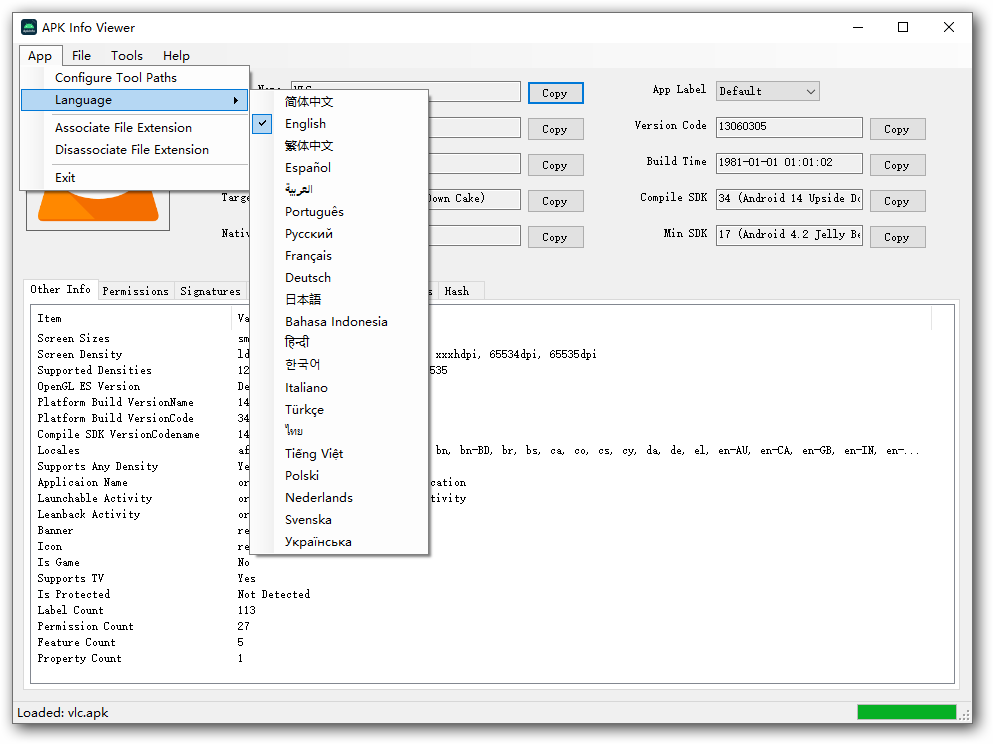
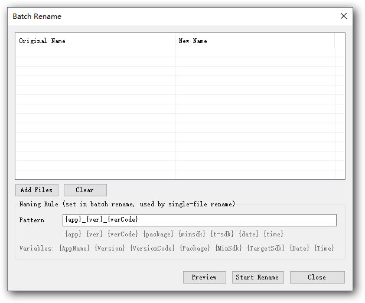
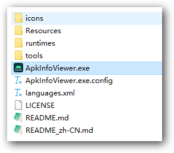

# Apk Info Viewer

中文用户请查看：[中文文档](README_zh-CN.md)。

This is an open-source project created by the [ApkInfoViewer team](https://github.com/kongfl888/ApkInfoViewer).

## Function Description

- Support four file formats: APK, AAB, APKS, and XAPK
- Support displaying common and other detailed APK information
- Support viewing permission information
- Support viewing attribute information
- Support viewing functional dependencies
- Support viewing signatures (requires JDK)
- Support viewing activity entry information (You can get the name of the activity that needs to be launched externally here)
- Support displaying icons (png+webp, but vector icons will not be parsed)
- Support multi language interface display (currently there are 20+)
- Support exporting report text documents to local disk (three types: original, simplified, and detailed)
- Support custom renaming and batch renaming
- Support optimization and batch optimization
- Support signature and batch signature (requires JDK)
- Support creating signature files (requires JDK)
- Support update check (manual required)
- Support redirecting to store pages
- Support redirecting to virustotal page
- Support hash value check
- Support file association (manual, optional to use administrator mode)
- Support automatic detection of required core components

## Snapshots





## System requirements

- Windows 7/8/10/11
- .NET Framework 4.8 or higher (please refer to [MSDN net-framework-48](https://learn.microsoft.com/en-us/dotnet/framework/install/versions-and-dependencies?redirectedfrom=MSDN#net-framework-48) for the corresponding versions of Windows and Netfx)
- Aapt2.exe is required (included in Android SDK Build Tools)
- JDK is required (optional, for signature functionality, including jarsigner and keytool)

## Automatic identification method for core components

1. Prioritize tools in the tools directory of this application
2. Automatically read system environment variables JAVA_SOME and ANDROID_SOME

## Aapt2 core components

You can get it from the Google page: [maven](https://maven.google.com/).

Or download from here: the 32bit uses [aapt2-8.0.2-9289358-win32_i386.jar](https://github.com/kongfl888/ApkInfoViewer/releases/v1.0/aapt2-8.0.2-9289358-win32_i386.jar) , and the 64bit uses [aapt2-9.5.1-16666295-win32-amd64.jar](https://github.com/kongfl888/ApkInfoViewer/releases/v1.0/aapt2-9.5.1-16666295-win32-amd64.jar).

Download the corresponding version, then use decompression software to extract the jar, and the corresponding exe application file can be obtained. Place it in the tools directory or manually specify the path (specified in the software configuration form)

*Note: This software does not support aapt.exe*

## WebP icon component

If you need to enable the display of WebP icons, you need to copy the `runtimes` folder to the folder where ApkInfoViewer.exe is located.

If the `runtimes` folder is not packaged together, you can download it here: [libwebp_all_1.6.1](https://github.com/kongfl888/ApkInfoViewer/releases/v1.0/libwebp_all_1.6.1.zip).




## Multilingual Localization

If you need to add a new language, please add new data to both alias.tsv and `language.xml`, and include it in one file `./Resources/permissions.[LanguaeCode].csv`

LanguaeCode is specified in `language.xml`, for example:

`<lang name="English" short="en">`

Regarding adding a var for each language item in `languages.xml`,

1. Copy a copy of `alias.tsv` from the root directory and rename it as `alias_new.tsv`,
2. Fill in all translated aliases with `alias_new.tsv`,
3. Then run `./scripts/addvar.sh "新项目"`

Afterwards, you will receive a new languages.xml file. Please verify that the new file is correct before submitting.

*The default interface is Simplified Chinese.*

## Signature

Supports V1, V2, V3, V4,

But the signature mainly depends on the judgment of the signing program itself, so you may find that your Arm64. APK may not sign V1.

## Compilation

### Method 1: Use Visual Studio

1. Open ApkInfoViewer.sln
2. Select 'Release' configuration
3. Click on "Generate Solution"

### Method 2: Use the MS-DOS command line

```cmd
cd ApkInfoViewer
msbuild ApkInfoViewer.csproj /p:Configuration=Release
```

## Download

You can get it from here：[Releases](https://github.com/kongfl888/ApkInfoViewer/releases)

## NuGet packages

- System.IO.Compression.ZipFile.4.3.0（MICROSOFT .NET LIBRARY, dotnet_library_license）

## Thanks (CRediT)

- [google aapt2](https://developer.android.google.cn/tools/aapt2#download_aapt2) (Main core components)
- [libwebp-net](https://github.com/imazen/libwebp-net) (WebP icon display support components)
