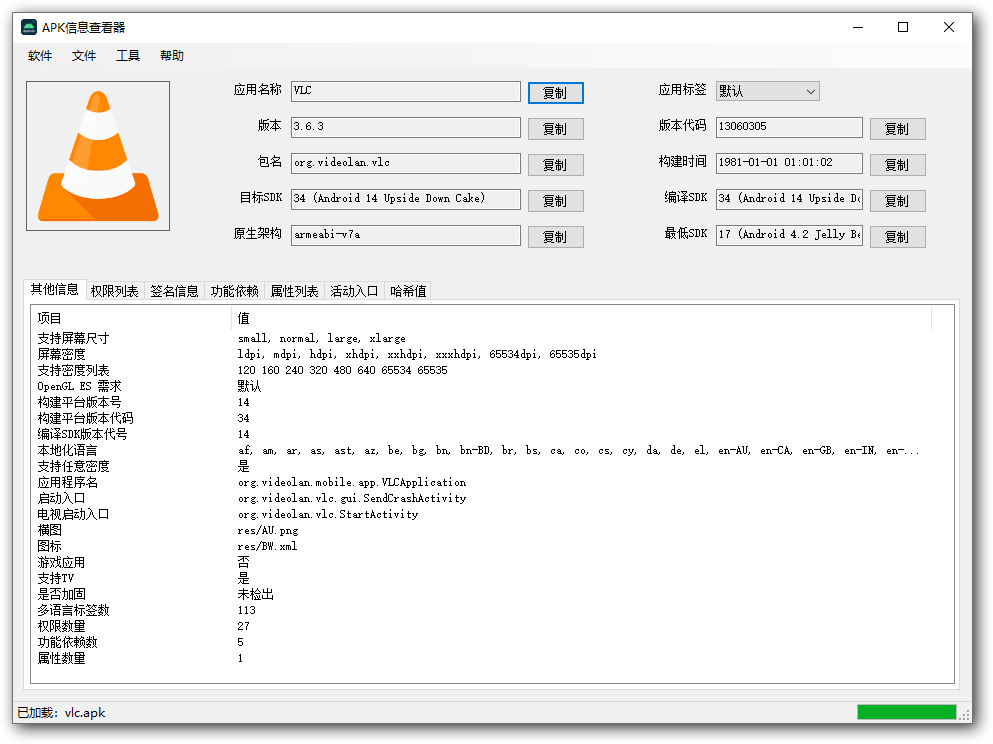
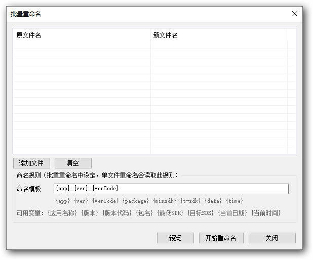
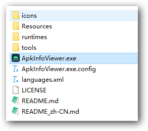

# APK信息查看器 Apk Info Viewer

For non Chinese users, please refer to [README.MD](README.md)

开源项目发布于：[ApkInfoViewer](https://github.com/kongfl888/ApkInfoViewer)

## 功能说明

- 支持 APK、AAB、APKS、XAPK 四种文件格式
- 支持显示常见和其他详细的APK信息
- 支持查看权限信息
- 支持查看属性信息
- 支持查看功能依赖
- 支持查看签名（需要 JDK）
- 支持查看活动入口信息（需要外部启动 Activity 名的可以在这里得到）
- 支持显示图标（png+webp，但矢量图标不会被解析）
- 支持界面多语言显示（当前有20+）
- 支持导出报告文本文档到本地磁盘（原始、精简、详细三种类型）
- 支持自定义重命名和批量重命名
- 支持优化以及批量优化
- 支持签名和批量签名（需要 JDK）
- 支持创建签名文件（需要 JDK）
- 支持更新检查（需要手动）
- 支持跳转商店页面
- 支持跳转在线查毒页面
- 支持哈希值检查
- 支持文件关联（需要手动，可选是否使用管理员的方式）
- 支持自动检测所需核心组件

## 预览截图





## 系统要求

- Windows 7/8/10/11
- .NET Framework 4.8 或更高版本 (Windows 与 Netfx 的对应版本请参考：[MSDN net-framework-48](https://learn.microsoft.com/en-us/dotnet/framework/install/versions-and-dependencies?redirectedfrom=MSDN#net-framework-48)
- 需要 aapt2.exe（必需，Android SDK Build Tools 中包含）
- 需要 JDK（可选，用于签名功能，包含 jarsigner 和 keytool）

## 核心组件自动识别方法

1. 优先本应用程序的 tools 目录下的工具
2. 自动读取系统环境变量 JAVA_HOME 和 ANDROID_HOME

## aapt2 核心组件

你可以从谷歌页面那里得到：[maven](https://maven.google.com/)。

或者从这里下载：[aapt2-8.0.2-9289358-win32_i386.jar](https://github.com/kongfl888/ApkInfoViewer/releases/v1.0/aapt2-8.0.2-9289358-win32_i386.jar)（32位）， [aapt2-9.5.1-16666295-win32-amd64.jar](https://github.com/kongfl888/ApkInfoViewer/releases/v1.0/aapt2-9.5.1-16666295-win32-amd64.jar)（64位）。

下载对应的版本，再使用解压软件解压该 jar，可得到对应的 exe 应用程序文件，将其放到 tools 目录下或者手动指定路径（在软件配置窗体中指定）

*注意: 本软件不支持 aapt.exe*

## WebP 图标组件

如果你需要启用显示 WebP 图标的功能，你需要将 `runtimes` 文件夹拷贝到 ApkInfoViewer.exe 所在的文件夹中。

该`runtimes` 文件夹如果没有一同被打包，那么你可以在这里下载：[libwebp_all_1.6.1](https://github.com/kongfl888/ApkInfoViewer/releases/v1.0/libwebp_all_1.6.1.zip)



## 多语言本地化

如需要新增新的语言，请在 `alias.tsv` 和 `language.xml` 同时新增新的数据，并加入一份 `./Resources/permissions.[LanguaeCode].csv`。

LanguaeCode 在 `language.xml` 中指定，比如：

`<lang name="English" short="en">`

关于使 `languages.xml` 每个语言项新增 一条 var，

1. 在根目录，拷贝一份 `alias.tsv` 并重命名为 `alias_new.tsv`，
2. 将所有已翻译的 `alias` 填入 `alias_new.tsv`，
3. 然后运行 `./scripts/addvar.sh "新项目"`

之后会得到新的 `languages.xml`，请核实新文件无误后再提交。

默认是简体中文界面。

## 签名

支持V1，V2，V3，V4，

但签名主要还是靠签名程序自己的判断，所以你会发现你的 Arm64.APK 可能不签 V1。

## 编译方法

### 方法1：使用 Visual Studio

1. 打开 ApkInfoViewer.sln
2. 选择 Release 配置
3. 点击 "生成解决方案"

### 方法2：使 用MSBuild 命令行

```cmd
cd ApkInfoViewer
msbuild ApkInfoViewer.csproj /p:Configuration=Release
```
## 下载

请移步至：[Releases](https://github.com/kongfl888/ApkInfoViewer/releases)

## NuGet 包

- System.IO.Compression.ZipFile.4.3.0（MICROSOFT .NET LIBRARY, dotnet_library_license）

## 致谢（CRediT）

- [google aapt2](https://developer.android.google.cn/tools/aapt2#download_aapt2) （主要核心组件）
- [libwebp-net](https://github.com/imazen/libwebp-net) （WebP图标显示支持组件）
